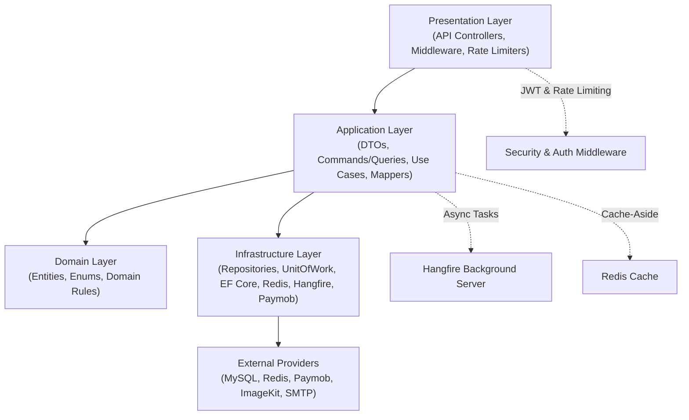

# E-Commerce-API-V1

[](https://github.com/omargamal1121/E-Commerce-API-V1/actions)
[](LICENSE)
[](#technologies)

A high-performance, modular, and extensible enterprise e-commerce API built with **ASP.NET Core (.NET 9)** and **Clean Architecture**.  
Designed for reliability, thread-safety, and horizontal scalability—featuring atomic inventory concurrency control, background job orchestration with **Hangfire**, distributed caching with **Redis**, **Paymob** payment gateway integration, dynamic promo code engine, and comprehensive JWT security.

---

## Table of Contents

- [Features](#features)
- [Tech Stack](#tech-stack)
- [Architecture & Design Patterns](#architecture--design-patterns)
- [Key Systems & Highlights](#key-systems--highlights)
  - [1. High-Concurrency Stock & Order Processing](#1-high-concurrency-stock--order-processing)
  - [2. Promo Code & Dynamic Discount Engine](#2-promo-code--dynamic-discount-engine)
  - [3. Background Jobs & Resilience (Hangfire)](#3-background-jobs--resilience-hangfire)
  - [4. Payment Integrations & Webhooks](#4-payment-integrations--webhooks)
  - [5. Caching Strategy (Redis)](#5-caching-strategy-redis)
  - [6. Security & Rate Limiting](#6-security--rate-limiting)
- [Modules Overview](#modules-overview)
- [Getting Started](#getting-started)
- [Docker Setup & Deployment](#docker-setup--deployment)
- [Testing Suite](#testing-suite)
- [API Documentation](#api-documentation)
- [Contributing](#contributing)
- [License](#license)
- [Author](#author)

---

## Features

- **Clean Architecture & SOLID:** Clear decoupling across Domain, Application, Infrastructure, and Presentation layers.
- **Atomic Stock Management:** Atomic database queries preventing overselling and race conditions under heavy concurrent checkout traffic.
- **Pessimistic & Optimistic Concurrency:** Row-level locks (`SELECT ... FOR UPDATE`) and EF Core concurrency tokens (`RowVersion`) inside atomic ACID transactions.
- **Promo Code Engine:** Percentage discounts stacking with product sales, order snapshotting, rate-limited public validation, and auto-activation/deactivation via background jobs.
- **Background Job Orchestration:** Background processing via Hangfire (auto-expiration of unpaid orders, async restocking, image processing, error alert dispatching).
- **Payment Gateway Integration:** Integrated Paymob checkout (cards, digital wallets), Cash on Delivery (COD), and HMAC-secured webhook callbacks.
- **Distributed Redis Caching:** Cache-aside pattern for product catalogs, categories, variants, and shopping carts with automatic cascade invalidation.
- **Security & Auth:** ASP.NET Core Identity, JWT authentication with refresh token rotation, OAuth2 external login (Google), and role-based access control (Admin / SuperAdmin / Customer).
- **Rate Limiting:** Built-in fixed-window rate limiters protecting public endpoints against brute-force and DDoS attempts.
- **Automated Testing:** Comprehensive xUnit and Moq test suite verifying business use cases, transactional rollback consistency, and job scheduling.

---

## Tech Stack

| Category | Technology |
|---|---|
| **Framework** | .NET 9.0 (C# 13) |
| **Database & ORM** | MySQL 8.0, Entity Framework Core 9 (Pomelo), Dapper |
| **Caching** | Redis (StackExchange.Redis) |
| **Background Jobs** | Hangfire (with MySQL Storage & basic auth dashboard) |
| **Authentication** | ASP.NET Core Identity, JWT (Bearer Tokens), Google OAuth |
| **Logging** | Serilog (Structured Console & Rolling File Sinks) |
| **Containerization** | Docker, Docker Compose |
| **Unit Testing** | xUnit, Moq, FluentAssertions |

---

## Architecture & Design Patterns



### Architectural Principles Applied:
- **Generic Repository & Unit of Work:** Unified commit and transactional consistency across all aggregate roots.
- **Result Pattern (`Result<T>`):** Eliminates unhandled exceptions for expected business logic results, returning standardized status codes and failure reasons.
- **Consistent API Response (`ApiResponse<T>`):** Unified response format for success, errors, pagination, and HATEOAS links.

---

## Key Systems & Highlights

### 1. High-Concurrency Stock & Order Processing
To eliminate race conditions and overselling without locking the entire table:
- **Two-Phase Checkout Guard:**
  1. **Pre-check:** Rapid no-tracking check against cached/DB quantities.
  2. **Atomic SQL Deduction:**
     ```sql
     UPDATE ProductVariants 
     SET Quantity = Quantity - @qty 
     WHERE Id = @id AND Quantity >= @qty
     ```
  3. **Transactional Rollback (ACID):** If any item in the cart fails the atomic deduction, the database rolls back the entire transaction. All previously deducted items are restored instantly, and the customer's cart is preserved.
- **Pessimistic Order Row Locks:** Order status modifications utilize `SELECT Id FROM Orders WHERE Id = {0} FOR UPDATE` within active database transactions, preventing race conditions between payment webhooks, user cancellations, and auto-expiration jobs.

### 2. Promo Code & Dynamic Discount Engine
- **Discount Stacking:** Applies percentage discount directly onto product subtotal (after product-level sales), strictly before shipping calculations.
- **Snapshot Immutability:** Orders save permanent immutable snapshots (`PromoCodeSnapshot`, `PromoDiscountPercent`, `PromoDiscountAmount`) so subsequent promo code edits never alter historic order totals.
- **Typed Lifecycle Enum:** Promo codes follow a strongly-typed lifecycle: `Upcoming`, `Active`, `Expired`, `Inactive`.
- **Public Rate-Limited Validation:** `POST /api/promo-codes/validate` is protected by a fixed-window rate limiter (10 requests/minute per client IP) to prevent code enumeration attacks.

### 3. Background Jobs & Resilience (Hangfire)
- **Auto-Activation & Deactivation:** Promo codes automatically schedule two timed Hangfire jobs on creation/date update:
  - Activation job scheduled for `StartsAt`
  - Deactivation job scheduled for `EndsAt`
- **Auto-Expiring Unpaid Orders:** Unpaid pending orders automatically expire after their configured TTL and trigger automated stock restocking in the background.
- **Dashboard Security:** Authenticated Hangfire Dashboard at `/hangfire` protected by `HangfireAuthFilter` (Basic HTTP Auth).

### 4. Payment Integrations & Webhooks
- **Paymob Gateway:** Integrates card checkout and mobile wallets with transaction reference tracking.
- **Cash on Delivery (COD):** Direct order placement flow with delivery verification workflows.
- **HMAC Webhook Verification:** Verifies payment provider callback signatures to prevent tampering and forged payment notifications.

### 5. Caching Strategy (Redis)
- **Cache-Aside Pattern:** High-read entities (Products, Categories, Subcategories, Collections) are cached in Redis with configurable TTLs.
- **Cascade Invalidation:** Updates to variants or products trigger targeted cache purging to guarantee eventual consistency.

### 6. Security & Rate Limiting
- **Identity & Tokens:** ASP.NET Core Identity with password hashing, account lockout after failed attempts, access tokens (JWT), and refresh tokens.
- **Rate Limiting Policies:** ASP.NET Core built-in rate limiters protecting against brute-force attacks on sensitive public endpoints.

---

## Modules Overview

| Project | Namespace | Responsibility |
|---|---|---|
| **Domain** | `Domain` | Business models, domain entities (`Order`, `Product`, `PromoCode`, `Cart`), enums (`OrderStatus`, `PromoCodeStatus`, `PaymentStatus`). Zero external dependencies. |
| **Application** | `Application` | Service interfaces, command/query services, DTOs, FluentValidation rules, mappers, business workflows. |
| **Infrastructure** | `Infrastructure` | EF Core `AppDbContext`, repository implementations, MySQL configurations, migrations, external integrations (Paymob, Redis, Hangfire). |
| **Presentation** | `E_Commerce` | REST Controllers, DI registrations, Middleware, Swagger/OpenAPI configurations, Rate limiter policies. |
| **Tests** | `Application.Tests` | xUnit test suite with Moq covering application services and core business rules. |

---

## Getting Started

### Prerequisites
- [.NET 9.0 SDK](https://dotnet.microsoft.com/download/dotnet/9.0)
- [MySQL 8.0+](https://dev.mysql.com/downloads/)
- [Redis](https://redis.io/download/)
- [Docker](https://www.docker.com/products/docker-desktop/) (optional, for full-stack containerization)

### Local Development Setup

1. **Clone the repository:**
   ```bash
   git clone https://github.com/omargamal1121/E-Commerce-API-V1.git
   cd E-Commerce-API-V1
   ```

2. **Configure `appsettings.json`:**
   Set your database connection string and secret keys in `PresentationLayer/appsettings.json`:
   ```json
   {
     "ConnectionStrings": {
       "DBbyMonster": "Server=localhost;Database=ecommerce_db;User=root;Password=yourpassword;"
     },
     "Jwt": {
       "Key": "your-256-bit-secret-key-here-min-32-chars",
       "Issuer": "ECommerceAPI",
       "Audience": "ECommerceUsers"
     },
     "Redis": {
       "Connection": "localhost:6379"
     }
   }
   ```

3. **Restore Dependencies & Build:**
   ```bash
   dotnet restore
   dotnet build PresentationLayer/E-Commerce.sln
   ```

4. **Apply EF Core Migrations:**
   ```bash
   dotnet ef database update --project InfrastructureLayer --startup-project PresentationLayer
   ```

5. **Run the API:**
   ```bash
   dotnet run --project PresentationLayer/E-Commerce.API.csproj
   ```
   Explore Swagger at `https://localhost:7288/swagger` or `http://localhost:5000/swagger`.

---

## Docker Setup & Deployment

The stack includes a production-ready `Docker-Compose.yml` orchestrating API, MySQL, and Redis:

1. **Configure Environment:**
   ```bash
   cp .env.example .env
   # Edit .env with your production credentials
   ```

2. **Build and Run:**
   ```bash
   docker compose up --build -d
   ```

3. **Verify Containers:**
   ```bash
   docker compose ps
   docker compose logs -f api
   ```

---

## Testing Suite

The repository includes a dedicated test suite using **xUnit** and **Moq**:

```bash
# Run all unit tests
dotnet test Tests/ApplicationLayer.Tests/E-Commerce.Application.Tests.csproj

# Run promo code and stock concurrency tests specifically
dotnet test Tests/ApplicationLayer.Tests/E-Commerce.Application.Tests.csproj --filter "PromoCode"
```

---

## API Documentation

Interactive OpenAPI/Swagger documentation is available upon launching the application:
- **Swagger UI:** `https://localhost:7288/swagger`
- **Hangfire Dashboard:** `https://localhost:7288/hangfire` (requires admin basic auth)

---

## Contributing

1. Fork the Project
2. Create your Feature Branch (`git checkout -b feature/AmazingFeature`)
3. Commit your Changes (`git commit -m 'feat: Add AmazingFeature'`)
4. Push to the Branch (`git push origin feature/AmazingFeature`)
5. Open a Pull Request

---

## License

Distributed under the MIT License. See `LICENSE` for details.

---

## Author

**Omar Gamal**  
- GitHub: [@omargamal1121](https://github.com/omargamal1121)  
- LinkedIn: [Omar Gamal](https://www.linkedin.com/in/omar-gamal-226232292/)
